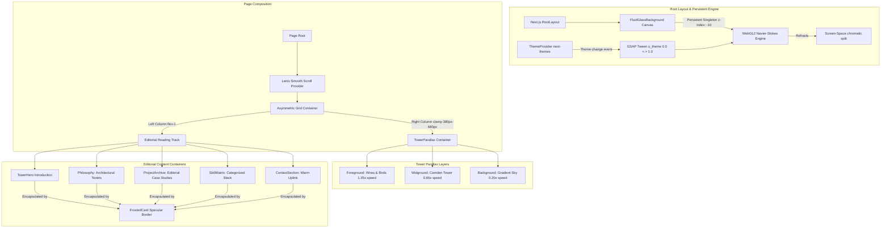

# Camden Lock Tower & Persistent FluidGlass Portfolio Redesign

*   **Author:** Rizki Aprita
*   **Status:** Proposed
*   **Date:** 2026-10-29

--------------------------------------------------------------------------------

## Overview

This project executes a comprehensive aesthetic and structural redesign of `aprita.web.id`. It transitions the portfolio from an aggressive, dark cyberpunk console into an inviting, warm vertical editorial experience anchored by a Camden Lock architectural tower illustration. 

The new experience pairs an asymmetric layered raster parallax tower (foreground silhouetted wires and birds, midground weathered brick tower with warm illuminated windows, and background twilight/sunlit sky) with high-contrast frosted glass content containers. Underneath, a persistent full-viewport WebGL2 Navier-Stokes FluidGlass shader provides responsive chromatic refraction across all vertical scroll coordinates, adapting its color harmonies across Day (sunlit cream/sky blue) and Night (dusk indigo/amber window glow) themes.

## The Problem

The existing portfolio design relies on military sci-fi tropes: pitch-black backgrounds (`#060608`), red alert accent tones, simulated command-line tickers, character decoding effects, and dense HUD grids.

While technically complex, this interface creates distinct business and communication failures:
1. **Intimidating Positioning**: Prospective clients and engineering peers perceive the interface as hostile, over-engineered, and unapproachable, implying difficulty in communication and collaboration rather than high-caliber craftsmanship.
2. **Degraded Readability & Content Accessibility**: Monospace typography, low-contrast dark themes, and heavy graphic overlays severely hinder basic portfolio consumption, case study review, and resume scanning.
3. **Misaligned Identity**: The current experience presents Rizki Aprita as an anonymous cybersecurity operator rather than a senior software engineer, web/mobile craftsman, and reliable technical partner.

## Goals

*   **Warm, Approachable Visual Identity**: Establish a welcoming aesthetic using the Camden Lock illustration's color palette (deep twilight indigo, warm coral/peach, dusty slate cyan, and incandescent amber).
*   **High-Contrast Content Scannability (WCAG AA Compliance)**: Ensure all text and project data inside frosted glass containers achieve a minimum contrast ratio of 5.5:1 against dynamic background layers in both Day and Night modes.
*   **Tactile Interactive Differentiation**: Retain and adapt the WebGL2 FluidGlass chromatic refraction shader as a persistent, full-viewport backdrop without compromising scrolling performance or mobile battery life.
*   **Dual Theme Day/Night Cohesion**: Synchronize the Tailwind CSS design system and the WebGL2 shader palette so theme toggling transitions smoothly between a radiant sunlit day and a cozy twilight evening.
*   **Streamlined Showcase of Real Work**: Replace mock terminal data and HUD dossiers with clear, structured editorial cards presenting actual production projects (`webProjects` from `src/utils/ProjectsData.js`).

## Non-Goals

*   **No 3D Tower Meshes**: The architectural tower will not use Three.js 3D geometry. It is strictly implemented using layered raster parallax slices with GSAP ScrollTrigger to keep asset weight and rendering overhead low.
*   **No Rewrite of Blog/Content Backend**: The existing Next.js App Router, Prisma ORM, and MDX processing pipelines remain intact; only presentation layouts and typography tokens will change.
*   **No Interactive Minigames**: The tower elements remain ambient visual companions; individual windows or building sections will not act as clickable mini-apps or gamified rooms that distract from project evaluation.

## Open Questions

*   **Question 1 [Resolved]**: Tower illustration layers will be hosted locally in `public/images/tower/` as compressed WebP files (`tower-sky-bg.webp`, `tower-midground.webp`, `tower-foreground.webp`) to eliminate external CDN network latency and maintain offline reliability, strictly bounded by a 350KB total payload budget.
*   **Question 2**: What exact typography pairing best balances the warm editorial tone without introducing excessive Google Font bundle weight? (Recommended: native system font stack with fallback to `@next/font/google` Plus Jakarta Sans).

## Critical User Journeys (CUJs)

### CUJ 1: Prospective Client Reviewing Case Studies (Desktop)

*   **Given**: A client arrives at `aprita.web.id` on a desktop browser seeking to evaluate technical competence and past projects.
*   **When**: The user scrolls down through the landing page.
*   **Then**: The user observes the Camden Lock tower parallaxing smoothly along the right edge, while the persistent FluidGlass shader ripples organically beneath the mouse cursor. Case studies appear in crisp, high-contrast frosted glass cards on the left track with immediate links to live demos and technical stacks, free from confusing terminal effects.

### CUJ 2: Recruiter / Peer Toggling Theme Mode

*   **Given**: A visitor prefers reading in a bright environment and clicks the theme toggle button in the navigation header.
*   **When**: The theme state changes from Night to Day.
*   **Then**: Tailwind background and text tokens transition smoothly over 750ms from twilight indigo/amber to sunlit cream/cerulean. Concurrently, the WebGL2 FluidGlass shader updates its color uniforms (`u_theme`), shifting refraction dispersion to match the sunlit palette without re-initializing the WebGL context.

### CUJ 3: Mobile Visitor Reading on a Low-Power Device

*   **Given**: A visitor views the site on a mobile smartphone with battery-saver mode enabled or `prefers-reduced-motion` set.
*   **When**: The user scrolls down through the portfolio.
*   **Then**: The tower illustration scales gracefully as an ambient background watermark (~25% opacity), frosted glass cards occupy full mobile width with readable margins, and Navier-Stokes fluid physics pause during reading pauses (idle throttling) to eliminate battery drain.

--------------------------------------------------------------------------------

## Technical Plan (Architecture)

### Architectural Overview

The redesign architecture separates the experience into three decoupled layers:
1. **Interactive Fluid Canvas (Base Layer)**: A persistent, full-viewport WebGL2 singleton canvas mounted behind all DOM nodes (`z-index: -10`), executing a Navier-Stokes fluid simulation with chromatic screen-space refraction.
2. **Layered Parallax Illustration (Middle Layer)**: An asymmetric, multi-plane raster illustration rendered in a fixed container (`z-index: -5`), manipulated via GSAP ScrollTrigger synchronized with Lenis smooth scrolling.
3. **Editorial Content DOM (Top Layer)**: Standard accessible HTML elements inside frosted glass containers (`z-index: 10`) featuring high-contrast specular borders, housing semantic portfolio sections.



### 1. Spatial Composition & Asymmetric Grid Architecture

The page layout shifts away from centered full-width blocks into a coordinated asymmetric two-track grid on viewports $\ge 1024\text{px}$:

*   **Left Editorial Track (55%–62% width)**:
    *   Hosts all readable content cards (`<FrostedCard />`).
    *   Uses max-width clamping (`max-w-2xl` to `max-w-3xl`) with generous vertical spacing (`gap-24` to `gap-32`) to establish breathing room.
    *   Maintains an unobstructed reading column where eyes can scan project descriptions and metrics without visually colliding with high-frequency illustration details.
*   **Right Tower Companion Track (38%–45% width, clamped `380px` to `680px`)**:
    *   Hosts `<TowerParallax />` inside a sticky/fixed viewport coordinate system.
    *   The tower graphic is anchored to the right boundary with an alpha mask gradient (`mask-image: linear-gradient(to left, black 70%, transparent 100%)`) along its left edge.
    *   This feathering guarantees that on ultrawide viewports (1440px to 4K), the illustration blends seamlessly into the background gradient without a sharp cut-off.
*   **Responsive Viewport Adaptations (< 1024px)**:
    *   On tablets and mobile devices, the layout collapses into a single vertical column.
    *   The tower parallax container shifts from an asymmetric side companion to a centered background ambient graphic with 25%–30% opacity and a CSS blur backdrop filter.
    *   Frosted glass content cards scale to `w-full` (92% effective screen width) with `16px` padding, ensuring zero horizontal overflow and maximum readability.

### 2. WebGL2 FluidGlass Persistence & Shader Refactor

The monolithic 844-line `FluidGlass.jsx` is decomposed and upgraded into a persistent engine under `src/components/fluid/`:

*   **Directory Structure**:
    ```
    src/components/fluid/
    ├── FluidGlassBackground.jsx   # Context lifecycle, canvas mounting, FBO management
    ├── fluidShaders.js           # Modular GLSL shader sources (advection, pressure, refraction)
    └── fluidConfig.js            # Physics constants, color maps, resolution scale
    ```
*   **Persistent Singleton Mounting**:
    *   Mounted once in `src/app/layout.jsx` or root `src/app/page.jsx` with `fixed inset-0 pointer-events-none -z-10`.
    *   Listens to global pointer events via a throttled window listener (`pointermove`, `pointerdown`) to inject fluid splat impulses.
*   **Shader Uniforms & Dual Theme Palette**:
    *   Adds uniform `uniform float u_theme;` (where `0.0` represents Day and `1.0` represents Night).
    *   When the user toggles theme via `next-themes`, a GSAP tween interpolates `u_theme` over 750ms with `power2.out` easing.
    *   In the fragment shader (`FS_SCENE` / `FS_REFRACT`):
        *   **Day Mode (`u_theme = 0.0`)**: Base ambient tint `#FDFBF7` (warm alabaster cream), clear cerulean sky refraction, lower dispersion (`etaR = 1.0 / 1.35`, `etaB = 1.0 / 1.45`), preventing colored fringes around black text.
        *   **Night Mode (`u_theme = 1.0`)**: Base ambient tint `#121018` (deep dusk indigo), warm amber window light refraction (`vec3(0.96, 0.62, 0.24)`), richer chromatic split (`etaR = 1.0 / 1.30`, `etaB = 1.0 / 1.70`).
*   **Performance Guardrails**:
    *   **512x512 FBO Simulation**: Navier-Stokes pressure, divergence, curl, and velocity buffers run strictly at `512x512` resolution. Only the final `FS_REFRACT` pass executes at full viewport resolution.
    *   **2.5-Second Inactivity Throttling**: An idle timer tracks pointer movements and scroll events. If no interaction occurs within 2.5 seconds, the render loop pauses fluid advection, eliminating continuous GPU wake cycles during reading.
    *   **Context Resilience**: Implements `webglcontextlost` and `webglcontextrestored` listeners to re-allocate textures and framebuffers without requiring a page reload.

### 3. Layered Parallax Tower Architecture

The visual storytelling is driven by `<TowerParallax />` using `gsap/ScrollTrigger` and `lenis`:

*   **Layer Breakdown**:
    1.  **Layer 1: Sky Gradient & Distant Clouds (`tower-sky-bg.webp`)**: Moves at `0.20x` scroll speed. Contains horizontal atmospheric gradients matching the theme palette.
    2.  **Layer 2: Architectural Tower Midground (`tower-midground.webp`)**: Moves at `0.65x` scroll speed. Contains the detailed Camden Lock tower, water tank, brick arches, and illuminated window frames.
    3.  **Layer 3: Atmospheric Foreground (`tower-foreground.webp`)**: Moves at `1.35x` scroll speed. Contains overhead telephone/tram cables, flying swallows/birds, and rooftop antennae that glide past content cards to establish dramatic depth.
*   **Scroll Synchronization**:
    *   Scroll progress ($0.0 \to 1.0$) mapped across the entire document height via `ScrollTrigger.create()`.
    *   Vertical scroll velocity is tapped and fed into `FluidGlassBackground` as a gentle vertical velocity splat, causing the fluid glass to react naturally to rapid scrolling.

### 4. High-Contrast Frosted Glass System (`<FrostedCard />`)

To eliminate "contrast mud" while maintaining tactile visual depth, `<FrostedCard />` implements a double-boundary specular structure:

*   **Structure**:
    *   **Backdrop Filter**: `backdrop-blur-md` (16px blur) to diffuse underlying illustration frequencies.
    *   **Solid Tint Fill**:
        *   Day: `bg-stone-50/85` (`rgba(250, 249, 246, 0.85)`).
        *   Night: `bg-[#121018]/85` (`rgba(18, 16, 24, 0.85)`).
    *   **Structural Border**: `1px solid` around perimeter (`border-stone-200/60` in Day, `border-amber-500/20` in Night).
    *   **Specular Highlight Ridge**: A pseudo-element `before:absolute before:inset-x-0 before:top-0 before:h-[1px]` rendering a bright horizontal specular gradient (`from-transparent via-white/80 to-transparent` in Day; `from-transparent via-amber-200/40 to-transparent` in Night).
*   **Contrast Invariant**: Ensures that all body typography maintains $\ge 5.5:1$ contrast against the card fill, exceeding WCAG AA requirements regardless of background movement.

### 5. Component Modernization & Retirement

*   **Retire & Remove**:
    *   `src/components/cyber/CyberCanvas.jsx` (Three.js wireframe scanlines)
    *   `src/components/cyber/SystemHud.jsx` (Terminal metrics overlay)
    *   `src/components/cyber/DecodeText.jsx` (Glitch decoding)
    *   `src/app/cyber.css` (Green/red terminal styles)
*   **Introduce & Modernize**:
    *   `src/components/tower/TowerHero.jsx` (Warm introduction, bio, status, role)
    *   `src/components/tower/PhilosophySection.jsx` (Tenets: Ambiguity to Structure, Speed to Refinement, Detail to Trust)
    *   `src/components/tower/ProjectShowcase.jsx` (Modular case study cards mapping `webProjects` from `src/utils/ProjectsData.js`)
    *   `src/components/tower/SkillsetSection.jsx` (Categorized craft matrix)
    *   `src/components/tower/ContactSection.jsx` (Warm collaborative inquiry card)
    *   `src/components/LayoutHeader.jsx` (Updated with warm amber accents and smooth theme toggle)

--------------------------------------------------------------------------------

## Alternatives Considered

### Alternative A: Full 3D Procedural Tower Model (Three.js / WebGL Mesh)

*   **Pros**:
    *   Allows arbitrary dynamic camera orbits and depth-of-field angles.
    *   Enables direct point-light interactions (e.g. cursor acts as a lantern casting real-time 3D shadows across brick surfaces).
*   **Cons**:
    *   Massive asset payload: 3D GLTF/GLB models with high-resolution textures exceed multiple megabytes, dramatically increasing Time to Interactive (TTI).
    *   GPU Contention: Running both a 3D Three.js geometry scene and a full-viewport WebGL2 Navier-Stokes fluid simulation simultaneously causes severe frame drops and battery drain on integrated graphics and mobile devices.
    *   Stylistic mismatch: Hard-surface 3D models struggle to capture the cozy, hand-drawn whimsical line work of the Camden Lock 2D reference illustration.
*   **Reason for Rejection**: Layered 2D raster parallax slices with alpha transparency achieve the exact hand-crafted aesthetic with 95% less asset weight and zero 3D geometry rendering overhead.

### Alternative B: Literal Thematic Rooms / Floor Sections (Model B)

*   **Pros**:
    *   High conceptual novelty where each portfolio section represents an actual physical room (e.g., Rooftop Observatory = Hero, Clockwork Workshop = Projects, Canal Basin = Contact).
*   **Cons**:
    *   Forces project cards and technical content into rigid, cramped illustrative boundaries.
    *   Catastrophic mobile UX: Fitting multi-paragraph case studies and live preview screenshots inside tiny room graphics creates nested scrollbars and high cognitive friction for prospective clients.
*   **Reason for Rejection**: The primary objective is to make Rizki Aprita's work scannable, clear, and easy to collaborate with. Model A (Asymmetric side-scaffolding companion with a dedicated editorial reading channel) provides the whimsical atmosphere while keeping content completely uncompromised.

### Alternative C: CSS-Only Frosted Glass (Retiring Fluid Simulation)

*   **Pros**:
    *   Zero WebGL context initialization or GPU shader execution.
    *   Simpler implementation relying strictly on native CSS `backdrop-filter: blur()`.
*   **Cons**:
    *   Completely discards the custom Navier-Stokes chromatic refraction fluid shader, eliminating the author's primary interactive differentiator and personal craft centerpiece.
*   **Reason for Rejection**: The fluid glass effect is an intentional showcase of senior frontend and graphics capability. With 512x512 FBO downscaling and a 2.5-second inactivity idle throttle, the WebGL2 implementation operates well within reasonable battery and CPU budgets.

### Alternative D: Hero-Confined Fluid Canvas (Current Implementation)

*   **Pros**:
    *   Simplest scoping: confined strictly to `Hero.jsx` (100svh) with no need to coordinate viewport persistence across the vertical scroll.
*   **Cons**:
    *   The tactile fluid refraction disappears the moment the user scrolls past the top fold, creating an abrupt aesthetic disconnect between the hero and subsequent sections.
*   **Reason for Rejection**: The author explicitly requested full-viewport persistent behavior across the entire vertical scroll.

--------------------------------------------------------------------------------

## Non-Functional Requirements

### 1. Performance & Latency
*   **Simulation FBO Downscaling**: The Navier-Stokes physics grid runs strictly on an offscreen $512 \times 512$ framebuffer texture regardless of device pixel ratio. Only the final screen-space refraction blit samples at full canvas resolution, capping GPU fragment operations to $\le 1.8\text{ms}$ per frame on integrated GPUs.
*   **Idle Throttling & Battery Conservation**: An inactivity watchdog listener suspends the WebGL requestAnimationFrame render loop if no pointer interaction or scroll event is detected for $2.5\text{seconds}$.
*   **Asset Budget**: The combined compressed payload for all 3 parallax raster layers (`tower-foreground.webp`, `tower-midground.webp`, `tower-sky-bg.webp`) must not exceed $350\text{KB}$.

### 2. Accessibility & Legibility
*   **WCAG AA Compliance**: All body text within `<FrostedCard />` maintains $\ge 5.5:1$ contrast against the frosted backdrop.
*   **Motion Sensitivity (`prefers-reduced-motion: reduce`)**:
    *   Disables GSAP ScrollTrigger parallax translations (layers render in static relative layout).
    *   Disables Navier-Stokes advection physics and pointer splat propagation (renders a static ambient gradient refraction).
    *   Disables Lenis virtual scroll interpolation and reverts to browser-native scrolling.

### 3. Reliability & Context Resilience
*   **WebGL Context Recovery**: Listens to `webglcontextlost` (calling `preventDefault()`) and `webglcontextrestored` to recreate shader programs and re-allocate textures without triggering unhandled exceptions or requiring user page refresh.

--------------------------------------------------------------------------------

## Detailed Implementation Plan

### Target Files to Create/Modify/Delete

#### 1. `src/components/providers/SmoothScrollProvider.jsx` (Create)
*   **Type / Scope**: Client Scroll Provider & GSAP Sync Wrapper.
*   **Proposed Changes**: Declares `"use client"`. Instantiates Lenis smooth scroll provider, registers ticker sync (`gsap.ticker.add((time) => lenis.raf(time * 1000))`), binds `lenis.on('scroll', ScrollTrigger.update)`, disables lag smoothing via `gsap.ticker.lagSmoothing(0)`, and properly cleans up listeners and destroys the Lenis instance on unmount.

#### 2. `src/components/fluid/fluidConfig.js` (Create)
*   **Type / Scope**: WebGL Configuration & Theme Constants.
*   **Proposed Changes**: Defines physics constants (dissipation, curl, vorticity, pressure iterations), 512x512 FBO dimensions, 2500ms idle timeout, and theme color vectors (`DAY_TINT`: `#FDFBF7`, `NIGHT_TINT`: `#121018`, `DAY_DISPERSION`: `[1/1.35, 1/1.45]`, `NIGHT_DISPERSION`: `[1/1.30, 1/1.70]`).

#### 3. `src/components/fluid/fluidShaders.js` (Create)
*   **Type / Scope**: GLSL Shader Library.
*   **Proposed Changes**: Exports modular GLSL source strings extracted from `FluidGlass.jsx`: `VS_BASE`, `VS_TEXEL`, `FS_CLEAR`, `FS_SPLAT`, `FS_ADVECT`, `FS_DIVERGENCE`, `FS_CURL`, `FS_VORTICITY`, `FS_PRESSURE`, `FS_GRADIENT`, `FS_NORMAL`, `FS_NORMALDELTA`, `FS_SCENE`, and `FS_REFRACT`. Explicitly includes `FS_NORMALDELTA` to supply normal differences to `FS_REFRACT`. Injects `uniform float u_theme;` into `FS_SCENE` and `FS_REFRACT` for Day/Night interpolation.

#### 4. `src/components/fluid/FluidGlassBackground.jsx` (Create)
*   **Type / Scope**: Persistent WebGL2 Background Singleton Component.
*   **Proposed Changes**: Declares `"use client"`. Implements an `isMounted` SSR check to prevent Next.js 16 App Router prerendering crashes. Mounts a fixed full-viewport canvas (`fixed inset-0 pointer-events-none -z-10`). Implements WebGL2 context initialization, 512x512 FBO ping-pong textures, throttled global pointer event listeners, GSAP theme uniform tweening on `next-themes` change, 2500ms inactivity idle advection timer, and `webglcontextrestored` recovery.

#### 5. `public/images/tower/` Raster Assets (Create)
*   **Type / Scope**: Static Parallax Illustration Assets.
*   **Proposed Changes**: Adds three local WebP layers:
    *   `public/images/tower/tower-sky-bg.webp`: 1440x2560px, compressed atmospheric sky gradient.
    *   `public/images/tower/tower-midground.webp`: 1440x2560px, Camden Lock architectural tower illustration with transparent background.
    *   `public/images/tower/tower-foreground.webp`: 1440x2560px, silhouetted cables, swallows, and lampposts with transparent background.
    *   Total combined payload must not exceed 350KB.

#### 6. `src/components/tower/TowerParallax.jsx` (Create)
*   **Type / Scope**: Asymmetric Parallax Presentation Component.
*   **Proposed Changes**: Declares `"use client"`. Uses GSAP ScrollTrigger and Lenis to coordinate the 3 multi-plane raster layers (`tower-sky-bg.webp` at 0.20x speed, `tower-midground.webp` at 0.65x speed, `tower-foreground.webp` at 1.35x speed). Applies horizontal alpha gradient mask feathering along the left edge. Collapses into a centered 25% opacity watermark on viewports $< 1024\text{px}$. Respects `prefers-reduced-motion` by disabling parallax translations.

#### 7. `src/components/tower/FrostedCard.jsx` (Create)
*   **Type / Scope**: High-Contrast Glass Container Primitive.
*   **Proposed Changes**: Declares `"use client"`. Renders an accessible card container with 16px backdrop blur, 84% solid tint (`bg-stone-50/85` in Day, `bg-[#121018]/85` in Night), 1px boundary border, and a top-edge specular highlight line (`before:absolute before:inset-x-0 before:top-0 before:h-px`). Guarantees WCAG AA text contrast ($\ge 5.5:1$).

#### 8. `src/components/tower/TowerHero.jsx` (Create)
*   **Type / Scope**: Homepage Hero Section.
*   **Proposed Changes**: Replaces the cyber hero with a warm introduction: avatar, author title, craft philosophy, and primary CTA linking to `/#portfolio`, styled in warm editorial typography.

#### 9. `src/components/tower/PhilosophySection.jsx` (Create)
*   **Type / Scope**: Engineering Philosophy Section.
*   **Proposed Changes**: Renders the three core tenets ("Ambiguity → Structure", "Speed → Refinement", "Detail → Trust") inside `<FrostedCard />` units with warm architectural iconography.

#### 10. `src/components/tower/ProjectShowcase.jsx` (Create)
*   **Type / Scope**: Case Studies Section.
*   **Proposed Changes**: Declares `<section id="portfolio" ...>`. Reads real production projects from `src/utils/ProjectsData.js` (`webProjects`). Renders modular case study cards displaying `title`, `description`, `stacks`, and `year`. Implements protocol normalization for domains (`project.domain ? (project.domain.startsWith('http') ? project.domain : "https://" + project.domain) : null`) and renders fallback status badges for projects lacking external links. Does not require missing `metrics` properties.

#### 11. `src/components/tower/SkillsetSection.jsx` (Create)
*   **Type / Scope**: Capabilities & Stack Matrix.
*   **Proposed Changes**: Presents structured proficiencies (Web Platforms, Mobile Apps, Cloud Backends, System Design) in clean frosted glass panels, replacing military HUD tables.

#### 12. `src/components/tower/ContactSection.jsx` (Create)
*   **Type / Scope**: Contact & Outbound Section.
*   **Proposed Changes**: Declares `<section id="contact" ...>`. Provides an accessible, collaborative inquiry interface with email, WhatsApp, GitHub, and LinkedIn links in a warm twilight card.

#### 13. `src/app/globals.css` (Modify)
*   **Type / Scope**: Global CSS Tokens & Stylesheet.
*   **Proposed Changes**: Adds standardized CSS variables with exact color parity:
    *   `--color-dusk-indigo`: `#121018`
    *   `--color-dusk-amber`: `#F59E0B`
    *   `--color-terracotta`: `#D97706`
    *   `--color-sun-cream`: `#FDFBF7`
    *   `--color-sun-cerulean`: `#38BDF8`
    Removes all leftover cyberpunk neon scanlines, CRT flickers, and cyber utility classes.

#### 14. `tailwind.config.js` (Modify)
*   **Type / Scope**: Tailwind Configuration.
*   **Proposed Changes**: Extends `theme.colors` with exact matching tokens:
    *   `dusk-indigo`: `#121018`
    *   `dusk-amber`: `#F59E0B`
    *   `terracotta`: `#D97706`
    *   `sun-cream`: `#FDFBF7`
    *   `sun-cerulean`: `#38BDF8`
    Adds custom border-specular utility classes and sets base background/foreground mappings for `next-themes`.

#### 15. `src/app/layout.jsx` (Modify)
*   **Type / Scope**: Next.js Root Layout.
*   **Proposed Changes**: Mounts `<FluidGlassBackground />` as a persistent background singleton beneath the theme provider. Ensures clean hydration with `next-themes` and safe SSR execution.

#### 16. `src/app/page.jsx` (Modify)
*   **Type / Scope**: Main Landing Page.
*   **Proposed Changes**: Wraps content in `<SmoothScrollProvider>`. Restructures page composition into the asymmetric grid layout. Imports `TowerHero`, `TowerParallax`, `PhilosophySection`, `ProjectShowcase`, `SkillsetSection`, and `ContactSection`. Removes all references to `CyberExperience` and `cyber.css`.

#### 17. `src/components/LayoutHeader.jsx` (Modify)
*   **Type / Scope**: Global Navigation Bar.
*   **Proposed Changes**: Removes `overCyber` state and hardcoded `#060608` styles. Replaces them with scroll-based theme-aware frosted navigation styling:
    `isAtTop ? "bg-transparent border-transparent" : "bg-stone-50/80 dark:bg-[#121018]/80 backdrop-blur-md border-b border-stone-200/50 dark:border-amber-500/20"`. Smoothly integrates with the theme toggle and links to `/#portfolio` and `/#contact`.

#### 18. Retirement & Deletion of Legacy Cyber Files (Delete)
*   `src/components/FluidGlass.jsx` (superseded by `src/components/fluid/`)
*   `src/components/Hero.jsx` (superseded by `src/components/tower/TowerHero.jsx`)
*   `src/components/cyber/CyberExperience.jsx`
*   `src/components/cyber/CyberCanvas.jsx`
*   `src/components/cyber/SystemHud.jsx`
*   `src/components/cyber/DecodeText.jsx`
*   `src/components/cyber/ProjectArchive.jsx`
*   `src/components/cyber/SkillMatrix.jsx`
*   `src/components/cyber/ContactUplink.jsx`
*   `src/app/cyber.css`

### Verification Plan

*   **Compilation & Build**:
    *   Run `pnpm build` (or `npm run build`) to ensure zero Next.js App Router build errors, zero missing component imports, and zero TypeScript/ESLint failures.
*   **Visual & Responsive Layout Audits**:
    *   Verify desktop layout ($\ge 1024\text{px}$): Tower parallax pinned to right track with smooth alpha feathering; left reading column cleanly aligned with no overlapping text.
    *   Verify mobile layout ($360\text{px} - 768\text{px}$): Content cards span full width (92%) with 16px margins; tower collapses to subtle background watermark; zero horizontal scrollbar.
*   **WebGL Performance & Battery Testing**:
    *   Confirm 60fps/120fps scrolling in DevTools Performance panel.
    *   Verify GPU activity drops to 0% after 2.5 seconds of user inactivity (idle advection throttle).
    *   Simulate WebGL context loss via `gl.getExtension('WEBGL_lose_context').loseContext()` and verify seamless recovery.
*   **Accessibility & Contrast Check**:
    *   Audit all card text against frosted backgrounds using Chrome DevTools Lighthouse / Axe accessibility checker; confirm $\ge 5.5:1$ contrast ratio across both Day and Night modes.
*   **Theme Synchronization**:
    *   Toggle theme mode via header toggle; verify smooth 750ms color tween of the WebGL fluid background synchronized with Tailwind DOM color transitions.

--------------------------------------------------------------------------------

*Drafted with EGM*
